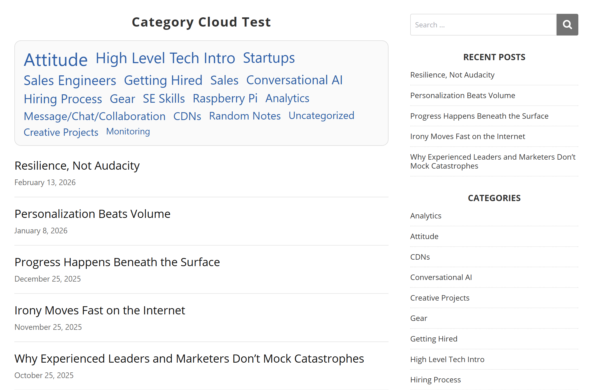

# Smart Category Cloud

Smart Category Cloud is a WordPress plugin that generates a dynamic category cloud where each category's size reflects both the number of posts it contains and how recently it has been active.

Selecting a category filters the displayed post list and shows the most recent matching posts first.



## Project Status

**Active Development**

Core plugin functionality is implemented and usable.

### Currently Implemented

- Weighted category scoring based on post count and recency
- Dynamic category font sizing
- URL-based category filtering
- Recent-post listing for the selected category
- Configurable posts per page through shortcode attributes
- Configurable minimum and maximum font sizes
- Responsive styling
- Optional separators between category links
- WordPress settings page for appearance options
- No external JavaScript libraries or jQuery dependency

### Not Currently Implemented

- AJAX filtering
- Query or result caching
- Pagination
- Configurable scoring weights
- Configurable recency decay
- Broader accessibility enhancements

## How Scoring Works

Each category receives a score based on two factors:

- **Post count:** logarithmically normalized relative to the site's largest category
- **Recency:** exponential decay based on the date of the category's most recent post

The current scoring formula weights:

- Post count: 65%
- Recency: 35%
- Recency decay interval: 90 days

The resulting score determines the category's font size between the configured minimum and maximum values.

These scoring weights are currently defined in code rather than through the WordPress settings interface.

## Usage

Add the shortcode to any WordPress page or post:

```text
[smart_category_cloud]
```

Optional shortcode parameters:

```text
[smart_category_cloud posts_per_page="10" min_font="14" max_font="42"]
```

### Parameters

- `posts_per_page` - Maximum number of posts displayed. Default: `10`
- `min_font` - Minimum category font size in pixels. Default: `14`
- `max_font` - Maximum category font size in pixels. Default: `42`

## Category Filtering

Selecting a category adds an `scc_cat` query parameter to the page URL.

For example:

```text
?scc_cat=wordpress
```

The page reloads and the plugin displays posts from that category in reverse chronological order.

AJAX filtering is not currently implemented.

## Settings

After activating the plugin, open:

**Settings > Smart Category Cloud**

The current settings interface includes an option to display separators between category links.

Additional configuration options are planned for future versions.

## Installation

1. Download or clone the repository.
2. Copy the plugin directory to:

```text
/wp-content/plugins/
```

3. Activate **Smart Category Cloud** from the WordPress Plugins screen.
4. Add the `[smart_category_cloud]` shortcode to a page or post.
5. Optionally configure appearance under **Settings > Smart Category Cloud**.

## Example Behavior

A category containing many posts and recent activity receives a higher score and appears larger than a category with fewer or older posts.

The cloud therefore emphasizes topics that are both substantial and currently active rather than ranking categories purely by total post count.

## Future Work

Potential future improvements include:

- AJAX filtering without a full page reload
- Transient or other query caching
- Pagination
- Configurable scoring weights
- Configurable recency decay
- Additional appearance controls
- Accessibility improvements
- Performance optimization for sites with large numbers of categories

## Development Notes

- Shortcode: `smart_category_cloud`
- PHP prefix/class convention: `SCC_`
- Text domain: `wordpress-smart-category-cloud`
- Minimum WordPress version: 5.5
- Minimum PHP version: 7.4
- No external JavaScript dependencies

## Changelog

### 1.2.0

- Added a settings page under **Settings > Smart Category Cloud**
- Added optional separators between category links
- Improved separator sizing relative to neighboring category font sizes
- Improved stylesheet formatting and maintainability

## License

GPL v2 or later.

## Contributing

Contributions, suggestions, bug reports, and improvements are welcome.
